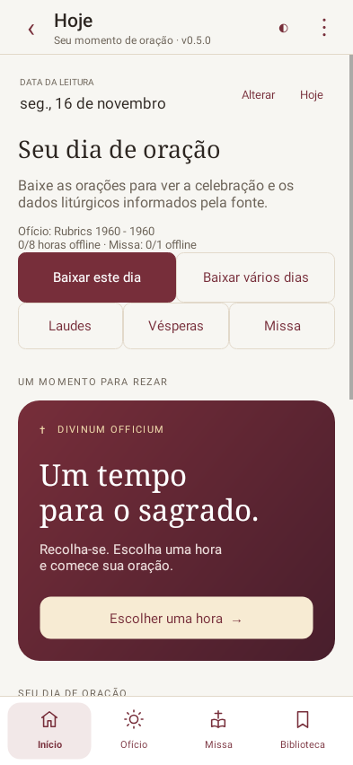
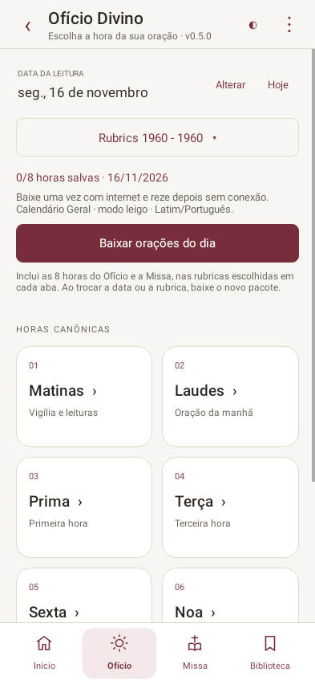
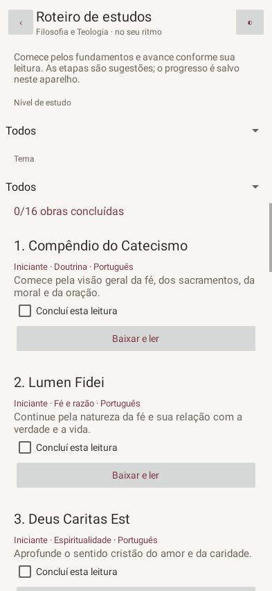
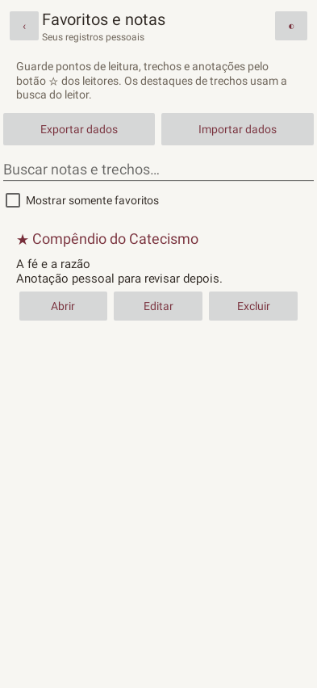
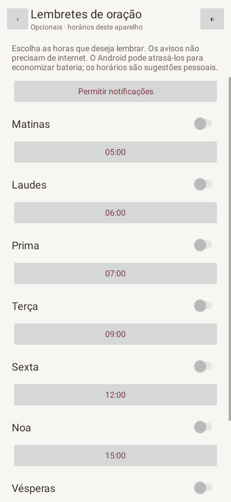
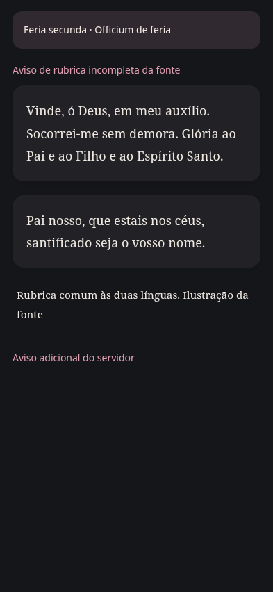

# Divinum Leitura — Android prototype

An independent Android companion for Divinum Officium, currently focused on Portuguese and Latin. This is an **AI-assisted prototype submitted for community review**, not an official Divinum Officium app or a production release.

[Documentação em português](README.pt-BR.md) · [Review and validation notes](docs/REVIEW.md) · [Book sources and editions](FONTES-BIBLIOTECA.md)

## What it does

- Native date/rubric navigation, eight canonical hours, Mass, light/dark/system themes and Latin/Portuguese/both reading modes.
- Explicit foreground downloads of 1, 3 or 7 days: eight hours and one Mass per day, preserving completed readings when interrupted.
- Durable snapshots keyed by date, rubric and Office/Mass, with SHA-256 verification and an atomic manifest. The local prayer reader blocks network loading, JavaScript and file/content access.
- Bookmarks, pasted excerpts and personal notes; local search in daily packages and downloaded HTML/PDF books.
- Optional local prayer reminders, disabled initially, and manual JSON export/import of personal records and selected settings.
- An optional 16-item philosophy/theology reference catalog with source/language attribution and a suggested study plan. Publications are not bundled in the APK.

The app obtains liturgical texts from the existing Divinum Officium website over HTTPS. It does not implement the liturgical calendar engine locally. A new date/rubric requires an online download. Source warnings and incomplete-edition notices are retained; general-calendar, lay-mode, expanded Latin/Portuguese content is used for daily packages.

## Status and downloads

The [evaluation directory](evaluation/README.md) contains the **v0.5.0 prerelease APK**, original source ZIP and SHA-256 checksums. The APK is debug-signed for evaluation and uses package `org.divinumofficium.reader`. The signing key is not in this repository; an independent build will normally have a different certificate.

Recorded automated results: **87 Android/JVM tests passing**, Android lint with 0 errors and 33 warnings, plus 17 capture, 49 offline-document and 62 online-reader Chromium checks. These are framework/fixture tests. **No physical Android device or real emulator was available.** Installation, actual website downloads, WebView behavior, notifications and document-provider integration still need device validation. The public server returned HTTP 403 in the development environment; CAPTCHA/TLS protections are not bypassed.

## Build

Requirements: JDK 17 or 21, Android SDK Platform 35 and Build Tools 35.0.0. Minimum Android version: 8.0 (API 26).

Set `ANDROID_HOME` or create an untracked `local.properties` with `sdk.dir=/path/to/android-sdk`, then run:

```sh
./gradlew assembleDebug testDebugUnitTest lintDebug
```

Windows: use `gradlew.bat`. APK output: `app/build/outputs/apk/debug/app-debug.apk`.

Optional browser checks (Node.js and Chromium):

```sh
npm install
npx playwright install chromium
node tools/check-daily.cjs --capture
./gradlew testDebugUnitTest
node tools/check-daily.cjs --verify
npm run test:reader
```

`CHROMIUM_PATH` selects a Chromium executable. See [review notes](docs/REVIEW.md) for the limits of this validation and a device checklist.

## Screenshots

These are Robolectric native-layout renders and a Chromium fixture render, **not photographs from a physical phone**. Notes shown are synthetic test data.

| Today | Office | Study plan |
| --- | --- | --- |
|  |  |  |

| Notes | Reminders | Offline prayer fixture |
| --- | --- | --- |
|  |  |  |

## Upstream and server load

The reference project is [DivinumOfficium/divinum-officium](https://github.com/DivinumOfficium/divinum-officium). No upstream source changes are part of this prototype.

Downloads are user-initiated and sequential, reuse valid cached readings and stop after three consecutive failures. A seven-day request can make up to **63 page requests**. There is no periodic background prefetch. This request pattern, caching policy and any preferred endpoint/rate limits need upstream review before wider distribution. No API stability or official endorsement is assumed.

## Licenses and privacy

App code: [MIT](LICENSE). Upstream notice: [Divinum Officium MIT](app/src/main/assets/LICENSE-DivinumOfficium.txt). PDF text extraction uses PDFBox-Android 2.0.27.0 and Bouncy Castle dependencies; [third-party notices](app/src/main/assets/THIRD-PARTY.txt) and full licenses are included. Book editions retain their own rights and attribution.

Permissions: INTERNET, POST_NOTIFICATIONS and RECEIVE_BOOT_COMPLETED. The app has no advertising, analytics or native JavaScript bridge. Downloaded content and personal records remain in app-private storage until the user explicitly exports their records. Auto-backup is disabled. Clearing app data or uninstalling removes private downloads/records.
